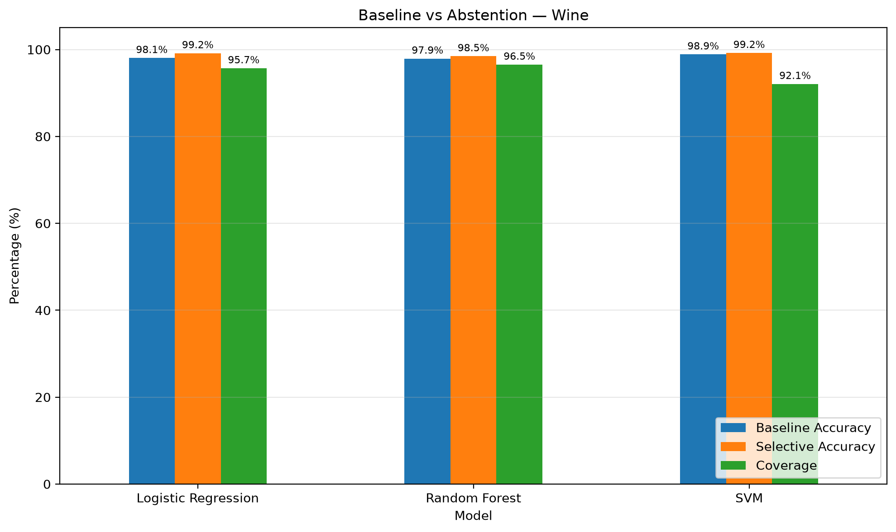
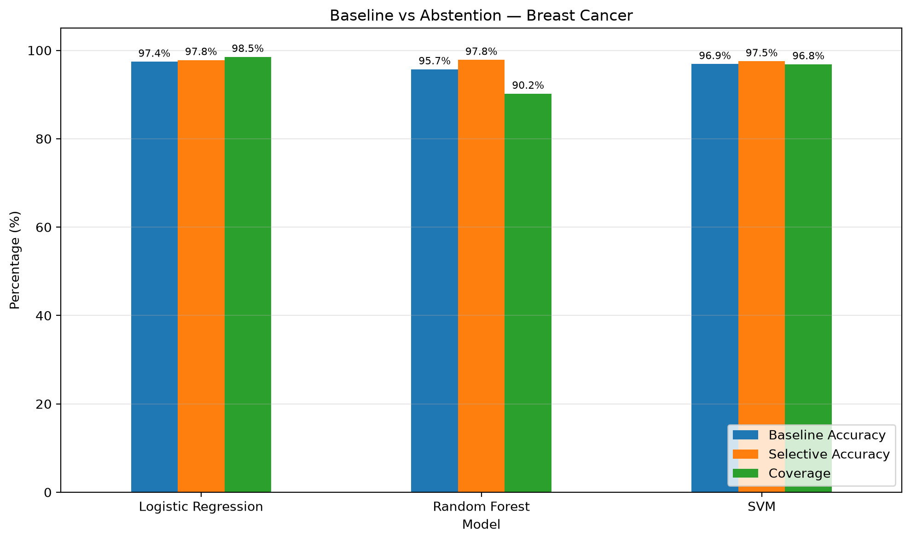

# Selective Classification: Evaluating Confidence-Based Abstention

## Project Overview

This project investigates **selective classification**, a machine learning approach in which a model can abstain from making predictions when its confidence is insufficient.

Instead of requiring a prediction for every input, the model accepts only predictions that meet a confidence threshold. This creates a trade-off between **selective accuracy** and **coverage**.

The project compares three classification algorithms across two datasets to examine how confidence-based abstention affects predictive performance.

## Research Questions

- How does confidence-based abstention affect prediction accuracy?
- How does increasing the confidence threshold affect coverage?
- Do different classifiers exhibit different accuracy–coverage trade-offs?
- Are the observed patterns consistent across datasets?

## Methods

Three classifiers are evaluated:

- Logistic Regression
- Random Forest
- Support Vector Machine (SVM)

For each prediction, the model's maximum predicted class probability is used as a confidence score. Predictions below a selected threshold are rejected.

The confidence threshold is selected using validation data, and performance is evaluated on held-out test data.

### Evaluation Metrics

- **Test Accuracy:** Accuracy before abstention.
- **Macro F1:** The unweighted average of class-wise F1 scores.
- **Coverage:** The proportion of test samples for which the model provides a prediction.
- **Selective Accuracy:** Accuracy calculated only on accepted test samples.

Repeated evaluation across 20 runs is used to examine the consistency of results.

## Datasets

- **Wine:** A multiclass classification dataset.
- **Breast Cancer Wisconsin:** A binary classification dataset.

Both datasets are available through scikit-learn.

## Experimental Results

The table reports mean results across repeated evaluation runs.

| Dataset | Model | Test Accuracy | Macro F1 | Coverage | Selective Accuracy |
|---|---|---:|---:|---:|---:|
| Wine | Logistic Regression | 98.1% | 98.1% | 95.7% | 99.2% |
| Wine | Random Forest | 97.9% | 98.0% | 96.5% | 98.5% |
| Wine | SVM | 98.9% | 98.9% | 92.1% | 99.2% |
| Breast Cancer | Logistic Regression | 97.4% | 97.2% | 98.5% | 97.8% |
| Breast Cancer | Random Forest | 95.7% | 95.4% | 90.2% | 97.8% |
| Breast Cancer | SVM | 96.9% | 96.7% | 96.8% | 97.5% |

## Key Observations

- On the Wine dataset, SVM achieves the highest mean baseline accuracy, while Logistic Regression achieves the same reported selective accuracy with higher coverage.
- On the Breast Cancer dataset, Logistic Regression maintains high coverage and strong predictive performance.
- Random Forest shows a larger difference between baseline and selective accuracy on the Breast Cancer dataset, alongside lower coverage.

These results illustrate why selective accuracy should be interpreted together with coverage rather than in isolation.

## Visualizations

### Wine Dataset



### Breast Cancer Dataset



## How to Run

Create and activate a Python virtual environment, then install the dependencies:

```bash
pip install -r requirements.txt
```

Run the evaluation scripts from the project root, according to their configured dataset and output paths. For example:

```bash
python src/repeated_evaluation.py
python src/second_dataset_evaluation.py
python src/final_visualization.py
```

## Limitations

- The experiments use two relatively small, established benchmark datasets.
- Results depend on data splits, random seeds, model settings, and confidence thresholds.
- Predicted probabilities may not be well calibrated.
- Mean results alone do not establish statistical significance.
- Selective accuracy can increase while coverage decreases, so neither metric should be interpreted independently.

## Future Work

- Evaluate probability calibration more systematically.
- Compare confidence thresholds and target-accuracy strategies.
- Report uncertainty estimates and paired statistical comparisons where appropriate.
- Test the approach on larger or more challenging datasets.
- Investigate alternative confidence and uncertainty estimation methods.

## Technologies

Python · pandas · NumPy · scikit-learn · Matplotlib

## Reproducibility

The repository includes scripts for evaluation and visualization, along with CSV outputs for inspecting experimental results. See the project files for implementation details.